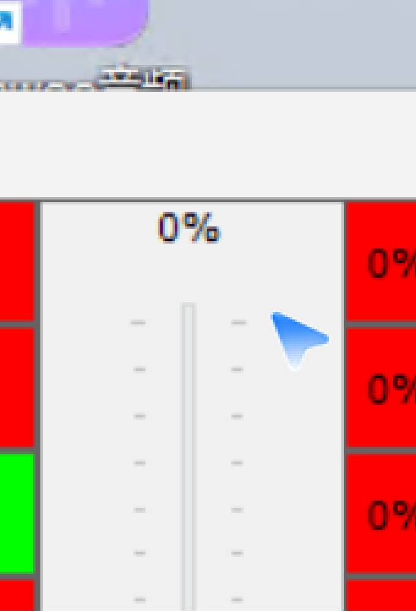
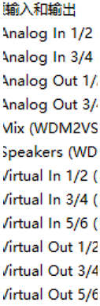
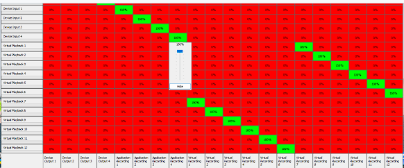

# LiveRig

[中文](README.md) · **English**

**A live-streaming audio rack for Windows: mic → VST3 chain → streaming app.**

LiveRig is not a DAW and not a virtual audio driver. It does one job: capture the mic reliably, run it through a VST3 chain, and send it to the streaming or voice app you choose. ASIO, WASAPI and MME backends, plugin chains, endpoint pairing, channel selection, metering and latency all aim at one thing: no failure during a live session.

> This repository is the product showcase and trial entry point. The core engine, plugin bridge, plugin parameter adapters and tuning data are not public. Trial builds are available through Releases / Issues.

## What it does

- **VST3 chain**: load EQ, compressor, limiter, de-esser and gate in a chain; parameters can be saved and undone.
- **Multiple backends**: ASIO / WASAPI / MME, selected from device capabilities; shared mode coexists with the streaming app.
- **Endpoint pairing**: pair any render / capture endpoint manually, with channel selection (`1/2`, `3/4`, mono, 16ch).
- **No guessing by name**: match by endpoint ID. VB-CABLE, BlackHole, VoiceMeeter and ROUTIST R2 have recommended rules, but are never forced.
- **Live safety**: measure the raw level before DSP and flag clipping every second; limiter, gain and mute state are auditable.
- **Agent interface**: a JSONL line protocol for scan / set / preset / scene / meters / undo, without clicking the UI.

## Who it is for

- Live streamers, voice rooms, podcasts and co-hosting setups that need a stable vocal chain;
- People who already own VST3 plugins but do not want a full DAW open just to go live;
- Users with multi-endpoint soundcards (ROUTIST R2, VB-CABLE, VoiceMeeter) who need the right channels routed;
- Users who want an Agent or script to control the rack state instead of remembering it manually.

## Current support

| Item | Scope |
|---|---|
| OS | Windows 10 / 11 (macOS / Linux endpoint support is under verification and is not claimed as supported) |
| Plugins | 64-bit VST3; 32-bit plugins are not supported |
| Backends | ASIO / WASAPI / MME; actual support depends on device enumeration and loopback checks |
| Virtual cables | Users install VB-CABLE, BlackHole, VoiceMeeter, PipeWire/Pulse virtual sinks themselves; LiveRig does not bundle or install drivers |

## Screenshots

## Download and trial

- Trial builds, release notes and known limitations are published under **Releases**.
- The product is in closed beta. To request a trial or report a compatibility issue, open an **Issue** with the soundcard model, OS version, host app and plugin version.
- This public repository does not contain the full source. Do not treat it as a clone-and-deploy package.

## Documentation

The detailed docs are currently in Chinese:

- [Quick start](docs/快速开始.md)
- [Plugin compatibility](docs/兼容列表.md)
- [FAQ](docs/常见问题.md)
- [Changelog](docs/更新日志.md)

## Why the core is not public

LiveRig is not just "a host that loads VST3". Its value is in the parts that are hard to copy:

- Real parameter names, ranges, units, enums and measured quirks for each plugin;
- Measurements and fallbacks across soundcards, sample rates and channel matrices;
- Gain, limiting and latency policy for live sessions;
- Agent tuning rules and scene-recovery behavior.

Those are the product, not a README giveaway. The public repository tells you whether it is worth trying; the core capability lives in the trial and licensed builds.

## License

The contents of this repository are product showcase material. Copyright belongs to the author. No permission is granted to redistribute, clone-deploy or commercially replace the contents or trial builds without written permission. Plugins, virtual audio drivers and third-party trademarks belong to their respective owners.
