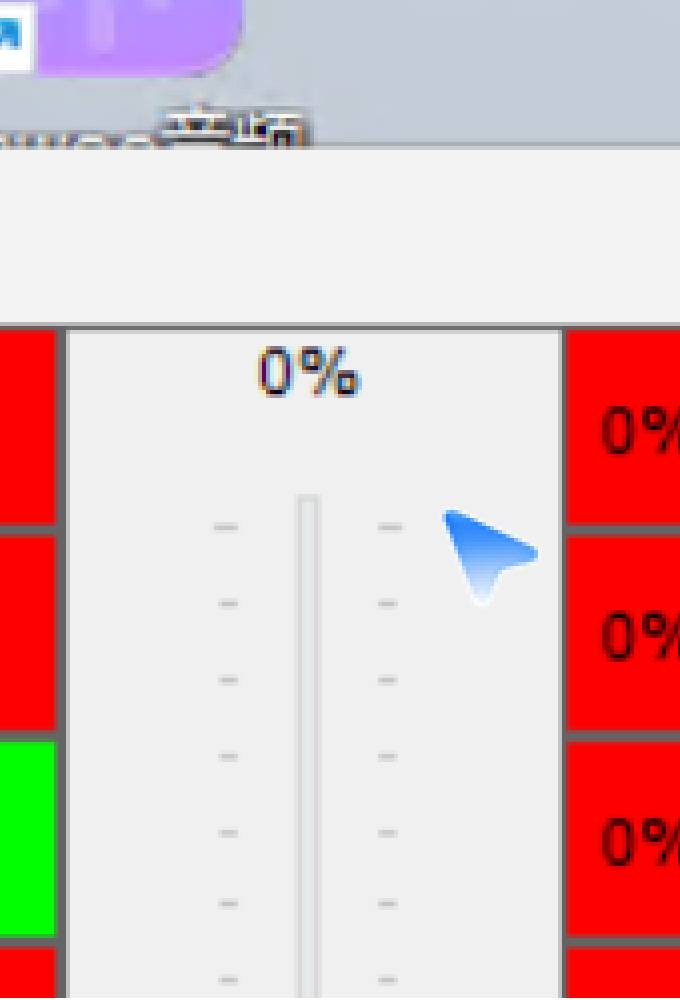
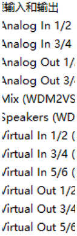
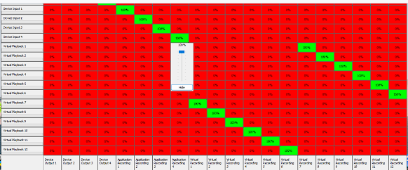

# LiveRig

**中文** · [English](README.en.md)

**Windows 上的直播机架：话筒 → VST3 插件链 → 直播软件。**

LiveRig 不是 DAW，也不是虚拟声卡驱动。它只做一件事：把话筒信号稳定地采集进来，过一整条 VST3 插件链，再送到你指定的直播/语音软件。ASIO、WASAPI、MME 多后端，插件链、端点配对、通道选择、电平与延迟都以“直播当场不出事故”为第一目标。

> 本仓库是产品展示与试用入口。核心引擎、插件桥、插件参数适配库和调音数据不公开；试用版通过 Releases / Issue 申请获取。

## 它能做什么

- **VST3 插件链**：EQ、压缩、限幅、去齿音、门限等按链加载，参数可保存、可撤销。
- **多后端**：ASIO / WASAPI / MME，按设备能力自动选择；共享模式与直播软件共存。
- **端点配对**：任意 render / capture 端点手动配对，支持按通道选择（`1/2`、`3/4`、单声道、16ch）。
- **不靠猜设备**：按端点 ID 精确匹配；VB-CABLE、BlackHole、VoiceMeeter、ROUTIST R2 等有推荐规则，但不硬凑。
- **直播安全**：DSP 前测原始电平，逐秒标记削波；限幅器、增益、静音状态可审计。
- **Agent 接口**：JSONL 单行协议，程序可以 scan / set / preset / scene / meters / undo，不用人点界面。

## 适合谁

- 直播、语音房、播客、连麦，需要一条稳定人声链的人；
- 已经有 VST3 插件，但不想为直播开一整套 DAW 的人；
- 有多虚拟端点声卡（ROUTIST R2、VB-CABLE、VoiceMeeter 等），需要把通道送对的人；
- 想让 Agent / 脚本接管机架状态，而不是靠人手记的人。

## 现在支持

| 项 | 范围 |
|---|---|
| 系统 | Windows 10 / 11（macOS / Linux 的端点适配在验证中，不写成已支持） |
| 插件 | 64 位 VST3；32 位插件不支持 |
| 后端 | ASIO / WASAPI / MME；具体以设备枚举和回环检查为准 |
| 虚拟通道 | 用户自行安装 VB-CABLE、BlackHole、VoiceMeeter、PipeWire/Pulse 虚拟 sink 等；LiveRig 不代装、不打包驱动 |

## 截图

## 下载与试用

- 试用包、版本说明和已知限制放在 **Releases**。
- 当前为内测阶段；需要试用或反馈兼容性问题，请开 **Issue**，注明声卡型号、系统版本、宿主软件和插件版本。
- 公开仓库不提供完整源码；请不要把本仓库当作可直接克隆部署的交付包。

## 文档

- [快速开始](docs/快速开始.md)
- [插件兼容列表](docs/兼容列表.md)
- [常见问题](docs/常见问题.md)
- [更新日志](docs/更新日志.md)

## 为什么核心不公开

LiveRig 的价值不只在“能挂 VST3”，而在下面这些不容易复制的部分：

- 每个插件真实参数名、范围、单位、枚举和踩坑结论；
- 不同声卡、不同采样率、不同通道矩阵下的实测与回退；
- 直播场景的增益/限幅/延迟策略；
- Agent 调参与场景恢复的规则。

这些是产品，不是 README 的赠品。公开仓库负责让你知道它值不值得试；核心能力在试用版和授权版里。

## 授权

本仓库内容为产品展示资料，版权归作者所有。未经书面许可，不得将本仓库内容或试用版用于再分发、克隆部署或商业替代。插件、虚拟声卡和第三方商标归各自厂商所有。
